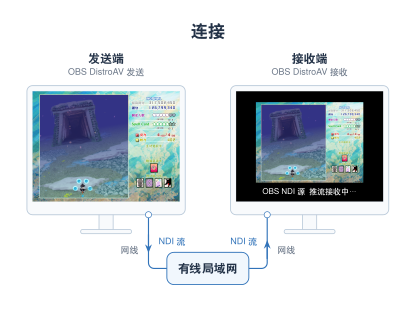
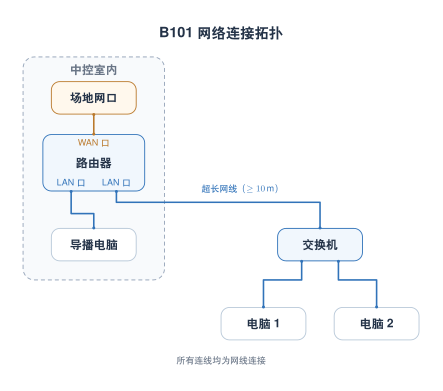

# 东方例会游戏推流的实验性方案：NDI

关于导播我知道的一切（二）

  作者：卡诺热机之梦
  邮箱：<a href="mailto:390177665@qq.com">390177665@qq.com</a>
  写于 <time datetime="2026-11-20">2026 年 11 月 20 日</time>

又见面了，我是卡诺热机之梦，你们可以叫我卡诺。

在上一篇文章里，我们介绍了导播的基本知识和 OBS 的基本用法，如果你看完了那篇，我相信你已经可以解决例会中绝大部分环节的导播问题。

不过，我们留了一个“小尾巴”，那就是在东方例会上打游戏并且转播游戏画面的问题。无论是在导播电脑上打游戏，还是通过腾讯会议转播，都存在一些不完美之处，例如无法推流多个游戏画面，或者网络连接不稳定。既然这些问题存在，那么有没有一个**无需专业设备**、**足够稳定和低延迟**、**扩展性强**、**价格亲民**的**较长距离视频流传输方案**呢？

有的有的，在这篇文章中，我们会介绍 **NDI（Network Device Interface）**，它使得利用**计算机网络**（而非专用媒体线缆和架构）来进行视频流传输成为可能。

总而言之，在这篇文章中，我们会介绍**如何在本地组一个千兆局域网用于我们的联机和 NDI 推流**，以及 **NDI 推流的有关步骤和注意事项**。这套方案搭建完成以后，连接了同一个局域网的电脑，将可以通过局域网实时、流畅地推送视频流。

## 前置说明

1. NDI 是幻想指南已经使用了很多届的一个解决方案，但是注意到，文章标题里有三个字：**“实验性”**。你需要花费很多人力、物力，做很多测试、接很多线，最后也就达到一个在一般人看起来很正常、无人在意的一个屏幕转播效果，如果哪里软件设置变了就会卡住，如果现场出了意外就会出放送事故。文中会记录很多我们踩过的坑，但是**笔者不对这个解决方案的稳定性和最终效果负责**，***use it at your own risk***。
2. 阅读本文需要一些 OBS 基础知识，我们假设读者已经了解了 [东方例会导播入门与 OBS 不完全指南](https://fantasyguide.cn/articles/tech_obs) 中的内容。
3. 有兴趣的朋友，可以自行去搜索或者跟 AI 聊天，以下是一些跟本文密切相关的话题~~（你可以直接喂给 AI 说我坐好了）~~：
    - 为什么无法通过 HDMI 长距离传输视频？在专业的现场转播中，有哪些长距离实时传输视频的解决方案？NDI 是如何实现视频推流的，这种方式相比于传统方式有什么样的不同和革命性？它如何让转播和多机位变得平民化？
    - 我和我的朋友都连接了校园网，但是我们无法在 MC 的多人游戏中发现对方开的局域网房间，有时通过对方的 IP 和端口进行连接也会失败，这是为什么？校园网和家里面通过路由器组建的局域网有什么样的区别？
4. 其实有一种方案并不需要这样折腾复杂的组网和软件也可以实现较长距离视频传播，并且价格还算亲民，叫做“USB 视频采集卡”（用来在导播电脑上采集另一台电脑的屏幕画面）+ “HDMI 转网线转换器/延长器”（用来延长视频传输距离，如果需要），在继续阅读本文之前，你也可以调研一下这个方案是否已经可以满足你的需求，以及例会的 staff 有没有现成的这些设备。
5. 和上一篇一样，遇到问题多问 AI。如果发现哪里讲错了，或者未来出现了新的 issue，或者你有什么好点子，**欢迎联系我**。

## 基本架构

### NDI

Network Device Interface (NDI) 是一种**基于 IP 网络**的**专业音视频传输技术**，它的核心目标是让计算机、摄像机、视频切换台等设备能够**通过普通以太网传输实时音视频信号**，而不必依赖传统的 HDMI、SDI 等专用视频线缆。

NDI 目前在 Vizrt Group 旗下以独立商业实体的方式运营，但其商业模式和开源策略比较独特：核心 SDK 是闭源的，但**通过免费授权广泛分发**；而围绕它的工具和生态中，则活跃着像 DistroAV 这样的真正开源项目。对于我们这种一个小小例会转播一个游戏画面的用途来说，**免费（特指软件）的方案完全够用**。

> - 有线网络是**稳定性要求**。一个例会里上百号人，每个人都在用手机连接蜂窝数据或者校园网 Wi-Fi，但是空气中物理层面的无线信道是有限的，这么多人都用同一个校园网 Wi-Fi 必然是体验极差的。在这么多设备都在尝试连接各种无线网络、都在发送无线信号的情况下，**我强烈建议你通过有线的方式进行组网和连接**。
> - 千兆网络是**硬性要求**。NDI 的 Full NDI (High Bandwidth) 视频传输方式传输 1080p@60fps 视频时的典型最大带宽是 125-165 Mbps，所以无论如何千兆级别的各种网络设备是**不容妥协的**。

### 局域网架构

在 NDI 框架下，我们有一台发布 NDI 流的电脑，称为发送端；有一台接收 NDI 流的电脑，称为接收端。

发送端和接收端需要接入**同一个千兆局域网**，而且这个局域网需要支持这两台电脑之间进行这样的操作：
- **广播 (Broadcast) / 设备发现**：NDI 默认通过 mDNS 协议在局域网中自动广播和互相发现，这决定了发送端开始发送 NDI 流以后，接收端能不能不指定 IP 就**发现**这个 NDI 流。
- **连接 (Connect)**：发现 NDI 流后，尝试发起和**建立连接**，建立连接以后才可以进行视频流的传输。

为了可以实现广播和连接的操作，我们至少要对两台电脑以及局域网（路由器等）进行这些设置：
- 电脑防火墙放行相应的端口、协议
- 路由器关闭各种隔离
- 两台电脑在同一子网 / VLAN
- 两台电脑可以正确访问本地网络，不会被各种奇怪的 VPN / 代理 / TUN 卡住
- ……

一般来说，校园网有各种隔离，不仅难以广播，而且大概率会阻止各种连接。所以最省事的方法就是不跟校园网进行不必要的搏斗，**用自己的设备组千兆局域网**，本地链路不易受外界干扰不用买流量，P2P 连接去中心化，而且想改什么设置自己改，不烧心。

顺带一提，组好局域网以后，非想天则、兽王园<del>、《我的世界》</del>等等**联机游戏**也可以走这个局域网，而且延迟包低、体验包好的。

但是，**上网是另一个问题**，组好了局域网以后，你还需要通过别的办法（例如电脑再连接校园网的 Wi-Fi、路由器 WAN 口连接可以上网的网口），你才可以~~登上信息高速路~~访问互联网。

### DistroAV

DistroAV（原名 OBS-NDI）是一个**开源**的 OBS Studio 插件，它让 OBS 能够通过 NDI 协议在局域网内发送和接收高质量、低延迟的音视频，从而摆脱采集卡的束缚。它的核心功能包括NDI Source（将网络上的 NDI 信号作为源引入 OBS）、NDI Output（将 OBS 的节目输出推成 NDI 流）、NDI Filter（将单个源或场景单独输出为 NDI 流）以及Preview Output（发送 OBS 预览画面）。不过，虽然 DistroAV 是开源的，但是它的运作依赖闭源（但是免费）的 NDI SDK。

有了这个强而有力 OBS 插件，我们就可以顺理成章地将 NDI 流接入我们的 OBS 导播工作流。

### 框架图示

<figure style="width: 900px; max-width: 100%; margin: 1.5em auto;">
  
  <figcaption>NDI 广播</figcaption>
</figure>

<figure style="width: 900px; max-width: 100%; margin: 1.5em auto;">
  
  <figcaption>NDI 连接</figcaption>
</figure>

## 局域网组网

接下来讲讲如何组网。

笔者计算机网络水平为零，这一章的内容将会非常朴素，并且极有可能有错误，欢迎斧正。

### 装备清单

我们把装备清单列在前面，但是不同的例会需求不同，并不是每一个例会和场地都需要下面的全套装备。所以，我按照这些装备的优先级依次列出：

- 千兆网口扩展坞（如果电脑没有网口的话）
- 千兆网线若干根（长度>=1m）
- 千兆路由器
- 超长千兆网线一根（长度>=10m）
- 千兆交换机（最普通的那种即可，插上电源适配器就可以往上插网线的那种，不需要可以设置）

> 如何判断我的网线/路由器是不是千兆的？
> - 找到一个你确定支持千兆的网口，用这根网线连接电脑和网口，打开系统的网络设置，选择“以太网”，查看“链路速度”，如果是 1000Mbps，那么就是千兆网线。
> - 找一根你确定是千兆的网线，用这根网线连接电脑和路由器的 LAN 口，和上面一样查看连接的“链路速度”，如果是 1000Mbps，那么就是千兆路由器。

### 基本原理

在一般情况下，我们称两台电脑之间可以互相联机、互相 NDI 推流、互相广播为两台电脑**有局域网连接**，称可以访问外面的互联网为**可以上网**。

通过下面这些方式进行连接，并且进行了正确的设置以后，两台电脑可以实现**局域网连接**：

- 两台电脑直接用网线相连

  > 这么连接非常简单，但是你需要手动设置两台电脑的 IP。
- 两台电脑连接到同一个路由器的 LAN 口

  > 路由器要注意关闭隔离，且路由器为两台电脑分配同一子网的 IP。
- 一台电脑连接路由器的 LAN 口，一台交换机的一个口连接路由器的 LAN 口，另一台电脑连接交换机的另一个口
- 两台电脑连接到同一台交换机

  > 通常也需要手动设置 IP。

通过下面的方式进行连接，并且进行了正确的设置以后，这台电脑可以实现**上网**（你通常还需要登录校园网网关）：

- 电脑用网线连接到可以接入互联网的网口（例如墙上的网口，AP 的网口等）
- 电脑通过 Wi-Fi 连接到一个可以接入互联网的无线网络（即便与此同时这台电脑没法通过有线上网）

  > 如果电脑通过 Wi-Fi 上网且以太网完全不能上网，你需要一些额外的设置，例如 `手动设置接口跃点数` 。
- 电脑用网线连接到一个路由器的 LAN 口，且这个路由器的 WAN 口连接到了可以接入互联网的网口（这个时候路由器的 LAN 口就是可以接入互联网的网口）

  > 可能需要解决校园网认证问题。
- 电脑用网线连接到一个交换机的一个口，且这个交换机的另一个口连接到一个可以接入互联网的网口

根据这些原理，你就可以根据 NDI 的框架、例会的需求自行灵活组网了。你可能需要检查和更改各种设置，请自行查阅检索资料，或者交给 AI，AI 非常擅长处理这种问题。~~（但是没有网怎么用 Agent 呢）~~

> 哦对了，现场一定要保护这些网线，例如用胶带做好固定，引导游客、选手注意和远离这些网线，不要踢到这些网线。有线千兆局域网可以很稳定，但是网线断了谁来都不管用。

### 案例分析

以幻想指南常见组网结构为例：

<figure style="width: 900px; max-width: 100%; margin: 1.5em auto;">
  
  <figcaption>幻想指南常见组网结构：B101 网络连接拓扑</figcaption>
</figure>

这种组网足以实现：

- 导播电脑通过有线网稳定上网
- 导播电脑可以发现电脑1 / 2的 NDI 广播和推流
- 电脑1和电脑2可以进行联机游戏
- 两台游戏电脑在中控室外，但是只需要拉一根超长网线

## NDI

### 安装 DistroAV 插件和 NDI

安装插件的具体方式可能会有变动，*假设*你之前**通过 Installer 安装了版本号 >=33 的 OBS 并且选择了默认安装路径**。

1. 前往 [DistroAV Releases](https://github.com/DistroAV/DistroAV/releases)，下载相应版本的 `windows-x64-Installer.exe`。
2. 运行这个 Installer，确认插件的安装目录确实是你 OBS 使用的目录，然后一路 `Next`，然后 `Install`。
3. 打开 OBS，上方菜单栏选择 `工具`，如果能看到 `DistroAV NDI 设置`，说明已经正确地把 DistroAV 安装到了 OBS 中。
4. 打开 `DistroAV NDI 设置`，点击 `Get NDI Library`，然后安装下载下来的 NDI Runtime。
5. 重启 OBS，打开 `DistroAV NDI 设置`，如果 `DistroAV 要求` 三个都是绿色√，说明 DistroAV 安装成功，已经可以使用。
6. （可选）你可以安装一个 [NDI Tools](https://ndi.video/tools/)，它可以帮你调试、修改设置，还可以实现不借助 OBS 直接采集屏幕并且进行推流。不过如果不需要改设置并且你不使用 NDI Tools 的这个屏幕采集推流功能的话，也并不是每台电脑上都必须装 NDI Tools。

> - 注意你的 OBS 是通过 Installer 安装的，还是通过解压压缩包运行的？是否是以便携版方式运行的？
> - OBS 从 33 版本开始，修改了插件安装的路径，现在插件统一安装在 `.../obs-studio/plugins/` 下。
> - 确保各种安装路径正确！

### 发送端

在发送端的电脑上，

1. 打开 OBS，配置好想要发送的场景，并且把这个场景推送到右边的“输出”，或者非工作模式下让这个场景保持打开。

    > 确保场景不是全黑的，为了方便调试可以播放一个有声音的视频，或者让一个人一直在这台电脑上打游戏
2. 菜单栏选择 `工具 > DistroAV NDI 设置`，勾选 `主输出`，写一个有辨识度的主输出名称
3. 点击 `确定`。

现在这个被输出的 OBS 场景就正在被 NDI 推流，处于可被发现、可推流的状态。

> 正在进行输出（包括这里的 NDI 推流、直播、录制等）的时候，你会发现没法改 OBS 的一些设置（例如输出分辨率）。改这些设置记得把这些输出都关掉。

### 接收端

在接收端的电脑上，

1. 打开 OBS，添加一个源，源的类型是 `NDI 来源`。
2. 在 `来源名称` 这里，应该能发现发送端的那个源，选择它。
3. 如果一切顺利，应该可以实时看到发送端发送的画面。检查画面、声音是否流畅、有无卡顿。

> 这个源的设置里，我强烈建议把 `超时` 设置为 `清除/重置最后接收到的内容(3秒)`，否则调试的时候很有可能被画面误导。

### NDI Tools

如果安装了 NDI Tools，这些功能也许对你有帮助：

- **Test Pattern**：可以从一台电脑发出测试图样，可供局域网中其他的电脑测试接收。
- **Studio Monitor**：可以接收局域网内其他的 NDI 推流，可以用于和 OBS DistroAV 进行交叉检查。
- **Screen Capture**：可以进行屏幕采集，并且直接发送 NDI 推流，而无需借助 OBS DistroAV。

### 疑难解答

DistroAV 官方的Troubleshooting：
[Troubleshooting](https://github.com/DistroAV/DistroAV/wiki/2.-Troubleshooting)

如果在配置调试阶段遇到问题，可以把上面的官方 Troubleshooting 丢给 AI，让 AI 慢慢查。下面是一些我们遇到过的问题：

#### 巨硬惊天大坑

什么？你说你的推流非常卡顿、甚至完全看不到画面，网络都是好的，防火墙也开了？别急，看看巨硬给我们的惊喜：

2025年8月，Microsoft 为 Windows 推送的某更新补丁会导致 NDI 通过 RUDP 连接方式进行推流时卡顿、无法接收画面和声音等等，受影响的系统版本和更新如下：

| 系统及版本 | 引入问题的补丁 | 修复问题的补丁 | 安装修复后的系统版本号 |
| --- | --- | --- | --- |
| **Windows 11 24H2** | `KB5063878` | **[KB5065426](https://support.microsoft.com/en-us/servicing/os/windows-11/2025/09/september-9-2025-kb5065426-os-build-26100-6584)** | **`26100.6584`** |
| **Windows 10 22H2** | `KB5063709` | **[KB5065429](https://support.microsoft.com/en-us/servicing/os/windows-10/2025/09/september-9-2025-kb5065429-os-builds-19044-6332-and-19045-6332)** | **`19045.6332`** |
| **Windows 10 21H2** <small>包括 Enterprise／IoT Enterprise LTSC 2021</small> | `KB5063709` | **[KB5065429](https://support.microsoft.com/en-us/servicing/os/windows-10/2025/09/september-9-2025-kb5065429-os-builds-19044-6332-and-19045-6332)** | **`19044.6332`** |

如果发送和接收 NDI 推流的电脑受到这些补丁影响，可能会导致默认设置下无法进行 NDI 推流。所以建议先检查系统、版本号，是否安装了引入问题的补丁而没有安装修复问题的补丁。

如果你的电脑确定受这个补丁影响，那么尝试安装修复问题的补丁或者更（gèng）新的补丁。如果你不想允许 Windows 自动更新，不想安装修复补丁，那么参照官方的 [Troubleshooting - Legacy issue with a Windows Update](https://github.com/DistroAV/DistroAV/wiki/2.-Troubleshooting#legacy-issue-with-a-windows-update) 进行设置，手动指定发送端和接收端电脑都使用 `Single-TCP`。（注意！使用 `Single-TCP` 连接可能不如默认的 `RUDP` 稳定）

#### 导播到一半发现推流黑屏

**如果发现捕捉不到那台电脑的画面**，现场排查（记故障电脑为电脑 A）：

- 确认电脑 A 的 OBS 中 `DistroAV NDI 设置` 中的 `主输出` 已开启，或者切换一下这个开关让它重新开始输出。
- 如果局域网中有第3台电脑，看看这台电脑的 OBS，能否在 NDI 源中看到电脑 A 的画面。同时也看看导播能不能看到第3台电脑的画面。
- 如果导播电脑安装了 NDI Tools，也可以使用 `Studio Monitor` 看看能不能看到电脑 A 的画面。
- 如果别的方式可以看到电脑 A 的画面，导播电脑的 OBS 也可以看到第3台电脑的画面，就是导播 OBS 死活看不到电脑 A 的画面，那么大概率是导播电脑的 OBS DistroAV 的问题，**这是可能发生的**。在确保不会穿帮的情况下（例如投影窗口下是 PPT），重启导播 OBS。

> 在例会现场，作为导播（或者协助导播的技术人员），如果下一个节目要用到 NDI，一定要提前检查一下 OBS 中能否看到那台电脑的画面。

## 结语

我想感谢一直以来为幻想指南提供组网设备的 Nipporita 和 九条理希和其他为此方案提供过设备的人，并且感谢九条理希一直以来担当“计算机网络顾问”。

感谢 Mikomeow，我们曾一起花了很多时间来排查这个 `Single-TCP` 问题，也感谢其他参与过此方案调试、测试的人。

**NDI 牛逼！**

<strong>愿大家的 NDI 一直顺！</strong>

<strong>Screen Director Mode Clear!</strong>

<strong>Thank you for reading!</strong>

