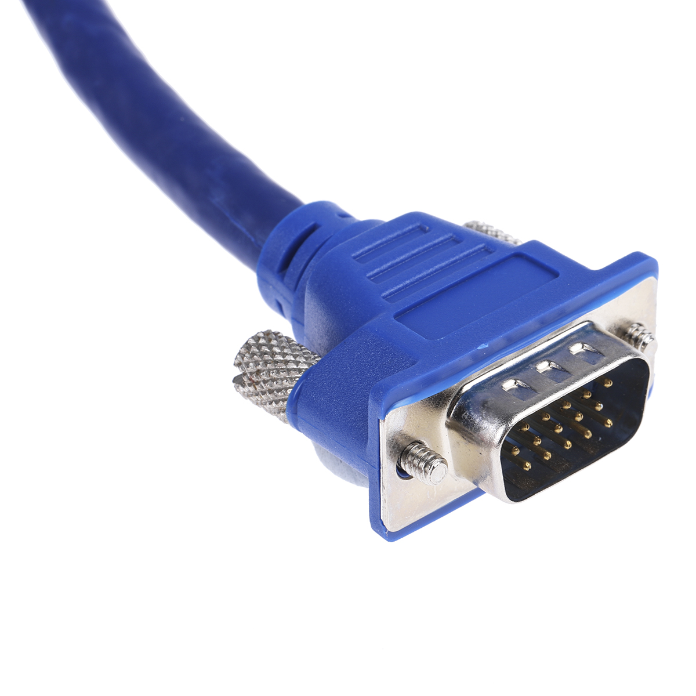
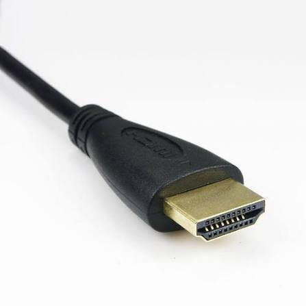
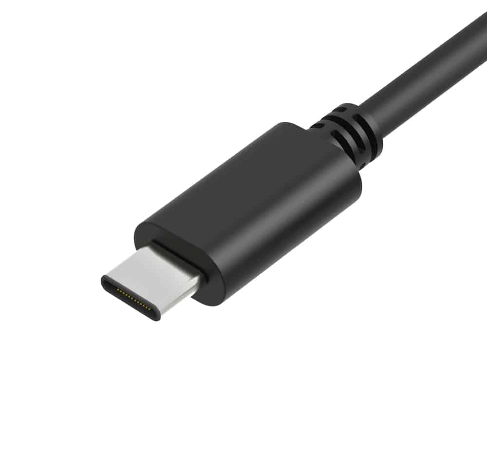
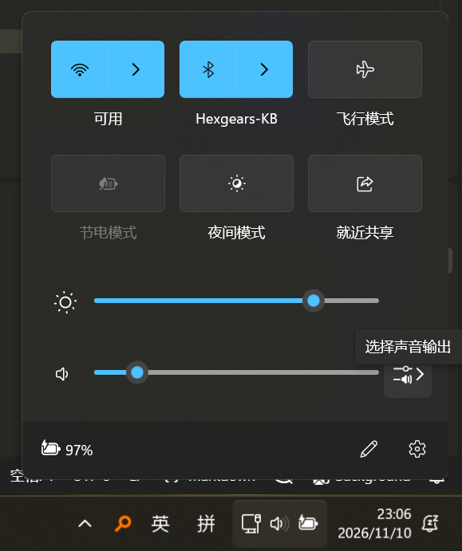
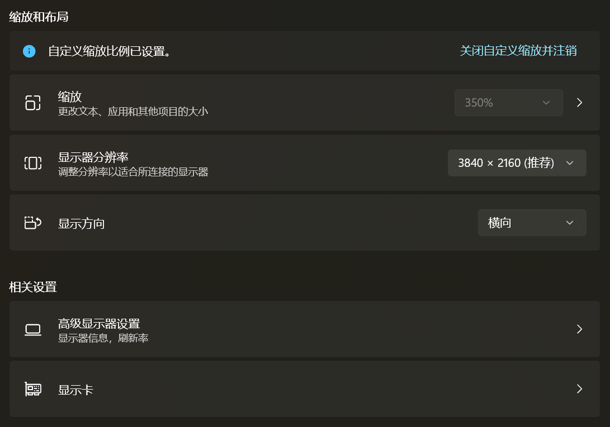
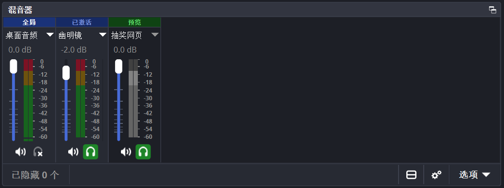

# 东方例会导播入门与OBS不完全指南

大家好，我是卡诺热机之梦，你们可以叫我卡诺。

你们也许注意到过，从第11届到第17届幻想指南，大部分时候都是我坐在教室前，或者中控室里，进行例会大屏幕的导播工作。

从早期只有播放PPT的需求，到14届为了上弹幕姬而用上OBS，再到15届为了3屏同框打随机绀用上NDI，经过这么多年来的经验积累和技术迭代，幻想指南的导播工作流逐渐变得更加完善，但也更加复杂。

在参加别的例会时，我也会注意到大家的导播有时会出一些小插曲，或者在切换不同的节目时不够丝滑，可能会影响观众的体验。

例会的大屏时刻被台下的上百双眼睛注视着，但人们容易轻视导播工作的复杂性、导播所需的责任感以及所背负的压力，事实上导播工作的流畅度、出错率、沉浸性能很大程度上影响观众对例会的观感。

事实上，“导播”这个岗位，是非常“universal”的，虽然每个例会的场地条件各不相同，有的在教室里，有的在专门的场地里（可以玩灯光、音响的那种），但是例会总要有一个大屏幕，整个例会的很多环节总要围绕大屏幕展开，所以每一个例会总要有一个人成为导播，这也意味着我们总可以从这里入手来提升例会的品质。

而“导播”有关的知识，也是非常“universal”的，学习一点知识不仅有助于在例会上做好导播的工作，还有助于在策划会、群聚时方向明确地调整房间里屏幕的信号源、投屏等等~~，甚至是在课堂/组会上调节投影设备~~。

在我随时都有可能消失但还没有消失的现在，我将从我个人的角度介绍如何从零开始上手一个东方例会的导播工作，并且介绍OBS的基本使用方法。如果（担任导播的）你有余力和意愿通过学习一些并不复杂的技能来让你的导播看起来更加专业，让例会的流程更加丝滑，那么我希望这篇文章可以多少帮助到你。

### 前置说明

1. 导播有关的知识很重要，但是更重要的是实际操作。不仅要能正常走一遍例会流程，还要做好现场出现BUG后能冷静处理的觉悟！
2. 导播的电脑，最好是一台性能中等及以上、没有暗病的游戏本，并且最好自带HDMI口或者有视频输出功能的USB Type-C口/雷电接口，以及网口。现场导播时必须全程插电，如果有条件可以插网线。在测试和现场，应时刻关注画面是否有卡顿、掉帧、黑屏，声音播放是否正常，排查设置或者性能问题。
3. 由于笔者的局限性，本文不可能涵盖所有的情况，也不能保证按照本文步骤一步一步操作下来就能完美无瑕地达成目标。但是如今AI是很好的老师，有问题可以多问问AI。如果你认为笔者哪里写错了，或者有某个有共性的问题需要说明，欢迎来联系我。
4. 这不是一个“导播的最高标准”或者“唯一标准”，每个例会的条件各不相同，导播们对技术的熟练度和信任程度也因人而异，所以在具体执行中，大家可以“丰俭由人”，只要效果足以让你接受或者满意，就好。
5. 技术可以让我们达成我们的目的，但也会增加学习成本，还会让现场的稳定性高度依赖于技术的可靠性和人的熟练度，从而把压力给到环节负责人，这就是我们借用某技术达成某目的所需付出的额外成本。当了这么多次导播，我也不敢保证我在中控室里的操作完全不会变形，也会感到一些压力。但是不必过度压力自己，也不必无限放大自己的小失误，这一点点小差错也许外面的观众根本就不在意。我说办例会就是为了和大家开开心心地一起玩。

## 连接场地设备

首先我们要实地考察或者从前辈那里了解，例会所使用的场地的屏幕的尺寸和连接方式，以及音响的使用方式等等。

### 连接方式

如果是教室里的电教设备，一般来说这个设备可以接受多种信号源。为了稳定性起见，我们一般不使用场地自己的电脑导播，而是会携带自己的笔记本进行投屏。查看讲台/中控桌上有没有形状如下图的线缆：

| VGA 线 | HDMI 线 | USB Type-C 线 | 3.5mm 音频线 |
|:---:|:---:|:---:|:---:|
|  |  |  |  |

前面3根主要是传输视频的线，后面1根是传输音频的线。（**但是！**HDMI线也可以传输音频，所以还需要进一步排查）

大部分的笔记本，应该至少有一个USB Type-C口可以输出视频，没有砍扩展性的游戏本还可能自带一个HDMI口。尝试将场地中的视频线缆与你的笔记本相连。如果很遗憾地你的笔记本无法与场地相连，那么你可能需要借或者购买一根转接线，具体什么类型的转接线视具体情况而定。

连接以后，首先尝试通过物理开关或者电教设备界面打开场地的大屏幕/投影仪，然后在大屏幕/电教设备界面切换视频输入为你所连接的视频线缆，或者切换为“笔记本”。启动完毕并且设置正确后，你应该可以看到大屏幕/投影仪上出现了你的电脑的画面。

接下来我们测试音频连接方式。如果场地有3.5mm 音频线，连接到笔记本上，确保场地音响已开启，然后在笔记本右下角的任务栏中打开音频设备切换入口：

在**输出设备**这里，你选择了哪个设备，这台笔记本的声音就会输出到哪个设备中。我们看下面这张图：

红框框出了三种我们可能会用到的音频输出设备，从上到下分别是：
1. “耳机”：一般来说输出到3.5mm的音频线，后面括号里的内容一般是你的声卡。
2. “扬声器”：一般来说输出到笔记本的扬声器。
3. “H27P6”：这是我的外接显示器的型号，这个输出设备会通过我的HDMI线输出到我的显示器，后面的括号里的内容一般是你的显卡。

如果场地同时提供HDMI线和3.5mm 音频线，你要仔细分辨场地的音频到底是走HDMI线还是音频线。你可以在这个界面切换不同的设备，然后尝试播放音乐，观察选择哪个设备的时候播放有声音。

[details]
#### 可能遇到的bug

- 本人曾在使用HDMI线向教室输出音频时，发现每一次播放音乐、音效，前几秒总是听不见，总是要等几秒才能听到声音。这可能是设备节能选项导致的bug。如果你也遇到这个问题，你可能需要查阅资料，通过修改注册表的方式来解决这个问题。
- 场地的音响设备，有可能你会觉得声音太小，就算把音量开到100%了，还是没法让场地内的所有人都听清。这时候你可能需要一些额外的软件（例如 `Equalizer APO`、`Voicemeeter`），来提升输出音量。

### 扩展显示器

成功连接教室的屏幕/投影后，在笔记本桌面右键，选择“显示设置”。

你会进入到设置的 `系统 > 屏幕` 界面。

你应该可以看到一个类似下图的界面。

这里的1、2便对应着你的屏幕、场地的屏幕（顺序可能不同的）。框内右下角的设置至关重要，这里可以设置如下值：
1. 复制这些显示器：你的屏幕和场地的屏幕始终显示同样的内容，本质上你只有一个桌面/显示屏。

    这是可以接受但是比较妥协的方案，因为如果这两个屏幕的尺寸不同，那么总有一个屏幕会被缩放，或者被拉伸；而且大屏幕上可以看到你的各种操作，不够沉浸式，甚至有剧透的风险（例如可以通过PPT提前偷瞄到下一道题的答案）。
2. 扩展这些显示器：你的屏幕和场地的屏幕可以显示不同的内容，你有多个桌面/显示器，并且可以决定它们各自显示什么样的内容。

    这是一个上等的方案，两个屏幕可以各自保持自己的最高分辨率，并且你在后台的各种操作可以不被台下看见。但是为了只在你的笔记本屏幕上操作就可以操纵大屏幕上的内容，我们后面会需要OBS。
3. 仅在X上显示：关闭某个显示器，只在其他显示器上显示。

所以我们选择“扩展这些显示器”，后面我们默认都采用这个设置。这么设置以后，
- 别忘了将你的笔记本屏幕设置为主屏幕。
- 并且将两个显示器的位置尽量按照它们的实际位置关系排列。
    - 如果你发现你的鼠标在自己的屏幕上怎么也找不到，那它有可能在另一个屏幕上，你要记得按照此页面排列的位置关系拖动回来！
    - 我不建议让笔记本屏幕的四角和外接屏幕相接，因为我们会本能地向这四个方向移动鼠标，来进行一些操作（例如右上角关闭最大化的窗口，右下角快速显示桌面）。

### 大屏幕参数

接上一小节，在 系统 > 屏幕 界面，确保你选择了场地的大屏幕，然后向下滚轮，就可以看到这个界面（其中上面的设置是对每个屏幕不同的）：

查看这个显示器的**分辨率**。尝试切换到最大的或者*推荐的*分辨率，并且检查切换后屏幕是否正常，有无不清晰、拉伸、失真。

一般来说，常规教室的投影仪/屏幕的比例可能为4:3，或者16:9。4:3的屏幕其分辨率可能是1024x768，16:9分辨率可能是1920x1080。（题外话：如今很多游戏本采用16:10的比例，2560x1600的分辨率。）同时，也可以在“高级显示器设置”里关注一下屏幕的**刷新率**。

记住显示器的分辨率，不仅后面设置OBS时要用到它，例会的**PPT**、小游戏的**界面**最好也按照这个规格来进行制作和适配，有关的**视频**（如OP、ED等等，音MAD除外）也可以参考这个分辨率制作。

如果有条件，强烈建议在例会开始前几天，在场地**测试**各种视觉资源的显示效果和音频的播放效果，例如PPT上的字是否在后排可以看清，色彩是否可以接受，音响重低音、高音效果如何，等等，然后根据实际情况进行调整。

## OBS 不完全指南（导播用）

### 软件介绍

Open Broadcaster Software（OBS）是由OBS Project开发的自由开源跨平台流媒体和录影程序。它可以有以下常见用途：

- 你要在网上的直播平台（例如B站）上**直播游戏**，或者你要当Vtuber，你可以在OBS中捕获游戏画面和你的皮套，并且美化一下你的直播画面，然后将视频流**推流**给直播网站。
- 你要**直播例会的舞台画面**，你可以在OBS中捕获来自相机的视频信号，然后同样地将视频**推流**给直播网站。
- 你是例会的**导播**，你希望优雅地向场地的**大屏幕播放**且只播放PPT、游戏画面、视频等等，最好还要挂一个弹幕姬，而且台下的观众看不出你使用的哪个视频播放器，也不会因为PPT界面泄漏而被剧透。
- 你想要急头白脸**录制**你在游戏的里的精彩操作，你也可以使用OBS捕捉游戏画面然后录制（而且这可能是最容易获得的**免费**录屏软件！）

下载地址：[Open Broadcaster Software | OBS](https://obsproject.com/)

很多朋友应该比较熟怎么用OBS去直播，但是没有想过把它当成导播的核心中控软件。下面的各项内容和设置，都以例会的大屏幕导播的工作流为前提，如果你平时会拿OBS干别的事，**记得备份你的设置和场景集合**。

### 基本设置

首先我们需要做一些基础设置，才能保证OBS按照我们所希望的方式运行。

打开OBS，在上方的菜单栏中，选择 `文件 > 设置`。

- 左侧选择“视频”，在“常规”选项卡，将这里的无论基础还是输出分辨率都设置成场地的分辨率，视情况选择帧率。
- 左侧选择“常规”，在“投影窗口”选项卡，勾选“投影窗口中隐藏光标”、“使投影窗口置顶”。
- （可选）左侧选择“输出”，你可以在这里设置录制的选项，例如保存位置、视频质量、编码器等等。

OBS界面右下角的“控制按钮”选项卡中，点击打开“工作室模式”。

### 插件安装

OBS有很强的扩展性，如果某个功能原版OBS还没有，也许有人做过一个插件，实现了这个功能。这里我先推荐大家安装下面这个插件：

- [Media Controls](https://obsproject.com/forum/resources/media-controls.1032/)，可以比较方便地操控各种媒体源。

### 认识界面

接下来我以第16届幻想指南我配置的场景来讲解OBS的基本界面。正确设置以后，你看到的OBS界面应该类似于下图：

- 场景：在左上角。每一个场景就是一套画面，选择某个场景，就可以在场景中编辑这个场景中显示哪些“源”，以及这些源的布局。
- 源：在左下角。一个源是一个最基本的“object”，例如说它可以是一个视频，可以是一张图片，可以是捕获的应用程序或游戏的画面，可以是某网页的内容，甚至可以是来自另一台电脑上的OBS输出（详见下一篇：NDI），等等等等。
- 预览：右上角的左侧屏幕。这是这个场景的显示布局，你可以在“源”那里一起调整。如同在Photoshop中一样，不同的源之间有上下图层关系，可以设置不同源的可见性、缩放、位置等等。
    - 事实上右边在输出的时候，你也可以在左边的预览偷偷调整另一个场景的布局。甚至预览和输出可以是同一个场景，你在左边重新调整了布局以后可以把这个场景的新布局输出到右边。
- 输出：右上角的右侧屏幕。这是OBS当前输出的画面，网络直播、录制以及待会儿我们要用的输出投影，显示的都会是“输出”这里的画面。当前输出的场景，就是冒号后面的内容。
- 转场：右上角的中间的按钮。点击“转场动画”，就可以将左边预览的场景，淡入淡出地切换到输出中。
- 源设置：右侧中间的横栏。这里你可以对源进行设置，如果你安装了Media Controls，那么对于媒体源还会显示媒体的播放控制。
- 混音器：右下角最左。对源的发声、声音大小进行调节。
- Media Controls：右下角第二个。对预览和输出中所有的媒体源进行播放控制（在停靠窗口中可以调出这个窗口）。
- 转场动画：右下角第三个。个性化定制“转场动画”按钮的实际效果。
- 控制按钮：右下角最右。一些输出控制和设置的快捷入口。

### 输出投影

这是让导播工作流区别于直播的**核心功能**。

目前，场地的大屏幕应该还没有OBS的画面，显示的还是你的桌面壁纸。

在“输出”这里，在画面处右键，“打开输出投影”，然后选择大屏幕。

操作后，大屏幕会显示“输出”的画面内容，这是OBS通过在大屏幕展示一个窗口实时输出画面内容实现的。在例会中，我们会一直保持这个输出投影常开，OBS会保持这个窗口一直在顶层。

#### 注意：多任务切换
因为这个投影是通过窗口实现的，尽管我们在OBS里设置了“始终置顶”，一些系统级别的操作仍可能会导致这个窗口不显示，从而露出底下的桌面。

例如Aero Peek：在任务栏中鼠标悬停在某个打开的应用上，出现窗口预览图后将鼠标移动到预览图上，那么系统会停止显示其他所有窗口，只显示被预览的窗口。

针对这种情况，有两种解决方案：
- 在需要切换应用程序时，使用 `Alt+Tab` 进行切换，而不是在任务栏中点击窗口。
- 直接关闭Aero Peek功能：
    
    1. 按 Win + R，输入 sysdm.cpl 并回车。
    2. 进入 高级 → 性能 → 设置。
    3. 打开 视觉效果 选项卡。
    4. 取消勾选 启用速览（Enable Peek）。
    5. 点击应用、确定。

除此之外，在窗口聚焦于输出投影时按 `Esc` 键，也会导致输出投影被退出，请注意。

#### 虚拟屏幕

在你看这篇文章的时候，例会应该还没开始，你大概率连不上场地的大屏幕（我去不早说），所以你可能只有一个屏幕（也就是你笔记本的屏幕）。那么你可能会在后面进行某些配置时遇到一些不便。

不过，可以安装一个“虚拟屏幕”，并且设置这个虚拟屏幕的尺寸、刷新率等和场地的大屏幕一致，这样就可以模拟一下接场地的大屏幕时的情景了。

我目前在使用 [Virtual-Display-Driver](https://github.com/VirtualDrivers/Virtual-Display-Driver)，它允许你手动设置屏幕的具体尺寸。但是这个虚拟屏幕（以及其他同类产品）会对你的显示设置进行一通爆改，可能会给你的显示驱动埋一些雷，所以使用时请保持谨慎，并且例会现场记得把虚拟屏幕关掉。

### PPT设置

1. 打开 PowerPoint，在上方菜单栏选择“幻灯片放映”。
2. 关注“监视器”部分，“监视器”选择大屏幕，并且勾选“使用演示者视图”。
3. 尝试放映幻灯片，预期的行为是大屏幕上正在放映幻灯片，你的笔记本屏幕上是“演示者视图”。

在演示者视图这里，你可以操控PPT，精确点击PPT上的元素（如果设置了动画的话），并且可以在右边看到下一页PPT的内容和这一页的注释（你可以在这里打一些小抄，例如这一页的题目的答案是什么）。这可以给你的PPT操作留一些余裕。

### 认识源

在动手操作源之前，请收集好例会需要使用的各种素材（例如视频、PPT、HTML等等），并将这些素材放到一个专门的文件夹中。OBS只会记住你指定的源在磁盘上的位置，不会在OBS中存储这些源的文件本身，所以设置好源以后，尽量不要乱动文件的位置。

在“源”选项卡右键，选择“添加源”，或者点击选项卡左下角的加号，来添加源。双击源，或者在右边中间栏点击源的“设置”，来对源进行设置。

一般我们一个源只负责干一件事，例如只播放一个媒体、只采集名字为“XXX”的一个窗口。

可以对源进行复制，默认情况下复制的源指向同一个“引用”，也就是说它们共享设置，并且共同加载源（不会因为你把一个浏览器源复制100遍，OBS就开100个浏览器去DDoS你这个网站），但是对同一个源的不同引用作为图层时可以有不同的变换（大小、缩放等等）。

下面，我们介绍几种例会中常用的源的添加方式及需要注意的设置。

#### 媒体

用于添加视频或者音频。

- 勾选“本地文件”，并且选择“浏览”，选择你想要播放的视频。~~不要学我这里把文件随手乱放在这种目录里。~~
- “当源变为活动状态时重新启动播放”这个选项非常搞，逻辑很奇怪，下面详细说明：
    - 如果**不勾选**这个选项
        - 那么在你启动OBS时，无论这个媒体源是否在你当前打开的场景中，这个媒体都会**自己直接开始播放**。所以在你把含有这个源的场景切换到输出前，**一定要注意源是否位于开头，是否会从开头开始播放！**可以利用Media Controls来调整。
        - 但是不勾选也有好处，当你把含有这个源的场景切换到输出时，源**不会立刻开始播放**。你需要通过Media Controls来让源开始播放。这比较适合你需要与台上的演职人员通过信号来确定播放时机的场景。
    - 如果**勾选**这个选项
        - 那么在你启动OBS时，这个媒体源**不会无缘无故开始自己播放**，除非含有这个源的场景正在输出。
        - 但是，如选项名所示，勾选这个选项后，**一旦将含有这个源的场景切换到输出，源就会立刻从头开始播放。**如果需要和演职人员商量何时开始播放，尤其需要注意这一点。
- 其他的有关播放的选项按需勾选。
- 如果你的媒体使用其他软件可以播放，但是在OBS中播放异常，那么你可能遇到了编码问题，请自己尝试关于编码的选项，或者对媒体进行一次转码。

#### 窗口采集

用于采集窗口画面。这是非常万能的采集，可以采集PPT的幻灯片放映窗口，也可以采集浏览器界面（也可以通过后面的“浏览器”源采集）。而对于游戏画面（例如STG、则），我们一般使用后面的“游戏采集”来采集。

- **窗口**：打开你想要采集的窗口以后，在“窗口”里选择那个窗口。你可以在上面的预览查看窗口的形态。
    - 如果你要采集PPT的幻灯片放映，注意像图片中这样选择名称正确的窗口。
- **采集方式**：如果你发现采集不到画面，可以尝试调整这里的采集方式。
    - 对于一些窗口，如果它不在前台，程序/系统可能会不渲染这个窗口，这可能会导致预览黑屏。
- **窗口匹配优先级**：一般如图选择，或者按需选择。

#### 游戏采集

对于游戏，至少以下3种投屏方法：
1. 在**导播电脑**上运行游戏，游戏画面在笔记本屏幕上，并且通过“游戏采集”采集到OBS内。

    你说的对，但是Windows以及各个显卡厂商留下的史山会给此方案带来很多困难，包括但不限于：
    - 如果OBS和游戏由不同的显卡进行渲染（例如你的游戏本又有核显又有独显），可能导致**无法采集到画面**。
    - 你现在外接了一个屏幕，那么游戏全屏的时候游戏该对哪个屏幕**全屏**呢？有可能全屏后游戏在大屏幕上，甚至横跨两个屏幕。
    - 进行游戏时，选手要进入中控室操控你的电脑，你没法掌控OBS。如果中途出了什么状况，你还要打断选手，切换到OBS，调整完以后再切换回来，以2UN的程序的稳定性和Windows的兼容性，来回切极有可能导致**游戏闪退**。

    正是由于以上原因，我认为在导播电脑上打游戏是比较麻烦、缺乏稳定性的。所以我更推荐后面的第3种方案。当然，如果你可以成功解决前两个问题，那这也不失为一种方案。以下措施对于各种游戏问题会有帮助：

    - 网上有很多关于“如何指定某程序使用指定显卡”的教程，根据这些教程指定OBS和游戏使用相同的显卡。
    - 无论你在哪台电脑上打游戏，我都建议你搭配 `dgVoodoo2` 补丁来运行游戏。可以参考 [dgVoodoo2对于东方STG游戏的详细配置](https://www.bilibili.com/opus/979214391346987015)，同时各大STG群（例如北京高校/地区STG群，群号：108048201）里也有很多预制配置文件。
2. 在**另一台电脑**上打游戏，然后通过**腾讯会议等软件**将画面共享到会议中，这台电脑也加入这个会议就可以看到游戏画面。然后通过“窗口采集”采集到OBS中。
    
    这个方案似乎大家也喜欢用，不过似乎容易受网络波动影响，而且我个人认为暴露腾讯会议的UI“不够优雅”。

3. 在**另一台电脑**上打游戏，然后通过**NDI**将游戏画面推流到局域网中，在OBS中添加一个“DistroAV源”，就可以采集到游戏画面。

    这是幻想指南目前采用的方案，我认为比较稳定（虽然有可能也要和OBS的游戏采集搏斗一下），并且可以在OBS中直接调整游戏画面，甚至可以**同时接受多个电脑的游戏画面**（参见第15届的三屏随机绀珠传），并且导播的电脑不受影响。*敬请期待NDI有关教程！*

下面按照方案1讲解游戏采集。

- 模式选择“采集特定窗口”，然后在窗口中选择你要采集的应用。
- 如果看不到画面，或者画面卡顿，尝试调整其他选项~~（其实我也不完全懂这些选项都有什么区别）~~

#### 浏览器

弹幕姬、抽奖、小游戏等等在浏览器实现的项目，除了打开一个浏览器然后通过“窗口采集”采集浏览器以外，也可以直接添加一个“浏览器”源。（**但是**这个方式有**已知BUG**，后述）

- 根据需求，添加一个URL，或者添加一个本地的HTML
- 设置适当的宽度和高度。
- **通过OBS控制音频**：如果你的这个网页会播放声音，记得勾选。
- **自定义CSS**：这里默认是有值的，默认值似乎是用来设置网页背景透明的。没有这个需求，就留空。
- 根据需求，选择是否勾选“当不可见时关闭源”和“当场景变为活动状态时，刷新浏览器”。
- 在“页面权限”，一般来说选择“OBS的完全访问权限”。

如果要和浏览器交互，选中“浏览器”源时，可以在右边屏幕中间，点击“设置”、“滤镜”右边的“交互”，然后就可以和页面进行交互了。

[fold open]
##### 输入法BUG
但是这个交互页面有老牌BUG：无法使用中文输入法输入中文。如果需要输入中文，可能需要手动复制粘贴。所以，建议只通过这个方式添加**只需展示无需交互**的页面，需要交互的页面则采用 `外部浏览器+F11全屏+窗口采集` 这套方案。

### 混音器

混音器有很多概念容易混淆，首先是关于音频输出的一些辨析：
- **输出/静音**：每一个音轨的左下角的小喇叭图标，默认开启。

    开启时，这个音轨的声音将被*输出*到直播、录像中。
- **监控（也叫监听）**：每一个音轨的右下角的一个耳机图标，默认关闭。

    开启时，如果这个音轨的状态是已激活，并且这个源在右边的“输出”里，你在OBS中指定的监听设备（如果是“默认”，那么就是你在Windows中指定的音频输出设备）中就可以*听到*这个音轨的声音。

在实际的例会中，我们**既要**通过“监听”**将声音输出到场地的音响**，**也要**通过“输出”**将声音输出到录像中**。

关于声音的来源，也有以下几种：
- 混音器里出现的**各种源的音频**，例如媒体、浏览器的声音。
    - 一般来说保持它们的**输出和监听都打开**。
    - 例会开始前别忘了检查你的**每一个**视频是否都打开了监听！
- **桌面音频**，是你这台电脑播放的声音，例如你放音乐的声音、打游戏的声音。
    - 这些声音会*直接输出*到音频输出设备，也会*出现在*我们的混音器中。
    - 如果你在混音器中也监听“桌面音频”，那么你就会听到*双倍的*桌面音频。
    - 但是你*需要*打开输出，来把桌面音频采集到录像中。
    - 所以这个音轨应该**打开输出，关闭监听**。
- **麦克风**，则可能是你的电脑的麦克风接收到的声音。
    - 我相信没有人愿意自己在中控室的闲聊或者跟其他staff的紧张对接被输出到场地的音响或者录像中，所以应该**保持这个音轨输出关闭，监听也关闭**。
    - 或者你可以干脆在 `文件 > 设置 > 音频` 中直接**禁用**麦克风。

掌握了上面这些以后，你就可以控制哪些源发出声音，以及它们的声音大小了。

[fold]
#### 音频的淡入淡出

在这种设置下，你确实可以通过“监听”将OBS内的声音输出到场地的音响。但是如果你是一个极致的完美主义者，你会注意到：当我们切换场景时，监听的音频是**突然切换**的，没有一个**淡入淡出**的效果。但是录像中，音频是有淡入淡出的。

这说明OBS是做了音频的淡入淡出的，“输出”中的音频才是**真正的**、OBS希望你用的那个音频输出；而“监听”，就如其名，是给你（中控人员）**检查**音频的播放效果的，而且监听是针对的每一个单独的音轨的，监听不会随着场景变换而有淡入淡出的效果。

对于完美主义者来说，这是一个小小的痛点。但遗憾的是，这个痛点目前并没有一个很好的解决方案……
- OBS目前不存在一个*原生的*将OBS的**最终音频混音**输出到某音频设备的方法。
- 有一个插件，叫 `Audio Monitor` ，它可以将OBS的最终音频混音输出到某音频设备。**但是**，我尝试的时候发现，使用这种方式输出的音频会逐渐积累**音频延迟**，最后可能音频相比于画面有2秒的延迟。
- 还有一种思路是将导播的OBS推流输出到电脑中*的另一个OBS*中，或者由*另一个软件*采集这个推流，然后把这个推流的音频播放到音频设备。**我没有测试过**这种思路，无法确定这样导致的**音频延迟**是否可以接受。

总而言之，在音频这方面，稳定性和低延迟的优先级肯定是高于淡入淡出的。请大家自己权衡各种方案的利弊。

### 场景布局

在场景中添加了各种源以后，你可以像在PS中一样调整不同的源的图层关系、大小、位置、缩放、可见性等等。

- 在“源”选项卡中选中和拖动源，可以调整图层关系。
    - 对于大多数场景，我推荐*在最下面的图层放一张PPT的背景图*（通常是以主视觉图为基础制作的）。这样在PPT和各种不同的场景之间切换时，可以保持某种“连续性”。
- 在“预览”中，你可以调节源的大小、位置、旋转等等。

    - 很有用的快捷键： `Ctrl+D` 可以*快速居中一个源*。
    - 一般来说，我们都应该充分利用屏幕，所以可以在*不改变比例的前提下*尽量将源缩放到长度和宽度有一个占满屏幕屏幕的尺寸。当然你也可以根据需求自行排版。

- 右键源，可以在“变换”中调整源的具体变换参数。
    
    - 一个很可能有用的参数是“裁切”。例如你的游戏采集有黑边，你可以通过一些小学级别的比例换算和加减法，计算这个源应该被裁切多少px。

### 场景管理

对于例会中的每一个真实场景（例如放映PPT、打STG、播放剧情视频等），你都应该在OBS中搭一个场景，并且维护良好的命名和顺序。

以我前面展示的那张图为例，我会按场景的实际内容命名每个场景，并且将它们按照先后顺序排序，并在前面标注这个节目在台本上的编号。

### 屏幕录制

如果场地的大屏幕在直播的相机下显示效果不佳，那么导播**通过OBS录制自己的屏幕**就会很有必要也很有性价比。在后期剪辑录播时，可以同时展示直播画面和录屏画面，如果某个环节只播放视频，还可以只播放录屏画面的视频。

- 在“控制按钮”选项卡，点击“开始录制”来开始录制。
- 在设置中检查录制保存的位置，确保你有**充足的磁盘空间**，建议10GB以上。
- 你的录制可能会遇到编码或者性能问题，所以在正式例会前**一定要试着录制一下**，看看录制会不会导致卡顿掉帧、录制文件是否成功保存、录制文件能否正常播放、正常看到画面听到声音，如果不行则需要调整有关设置。
- 作为导播，**一定要记得录制！！！一定要记得录制！！！一定要记得录制！！！**

## 在例会开始前……

在例会开始的前一天或者当天上午，如果你（导播）和主持人、导演还有时间和精力，非常建议大家一起对着OBS、PPT和台本过一遍例会的流程。请注意检查这些内容：
1. 媒体源是否都可以正常播放？是否都开了监听？
2. PPT是否可以正常播放？“幻灯片放映”和“演讲者视图”的位置是否正确？OBS捕捉到的是不是“幻灯片放映”？
3. PPT的答题部分，是否可以揭晓正确的答案？每一页是否备注了答案？主持人是否也知道答案？如果不小心多点了几下PPT，是否有泄露答案的风险？
4. PPT的内容、OBS的场景布置是否顺序和台本一致？在某个环节、主持人念某段串词时你应该操作PPT到哪一页/操作OBS到哪个场景？有没有还没制作PPT页面、还没搭建OBS场景的环节？
5. OBS的各个场景是否都按照预期运作？各种窗口采集是否采集到了正确的窗口？游戏场景在打游戏时能否采集到画面、是否掉帧？
6. OBS的录制功能是否正常？是否能正常录制和保存正常的录像？保存位置是否有足够的空间？

    ……

## 结语

导播是一个很抗压的职位。例会上几乎其他所有人的劳动成果，都要经过你的手和设备投放给观众。所以你应该将它们以最好的姿态展现给所有人，最好不要有疏忽。

但导播也是一个很神圣的职位。把大家和你的各种小巧思（也有可能是石）递给观众的机会，在你手上。也许例会结束以后很久，你还会记得你整出某个活以后，外面的观众持久的欢呼声，和每个staff冲进中控室向你比大拇指时的表情。

所以，接好设备，调好设置，搭好场景，练好操作，做好测试，然后静候例会开场——

**那么，我们开始吧？**